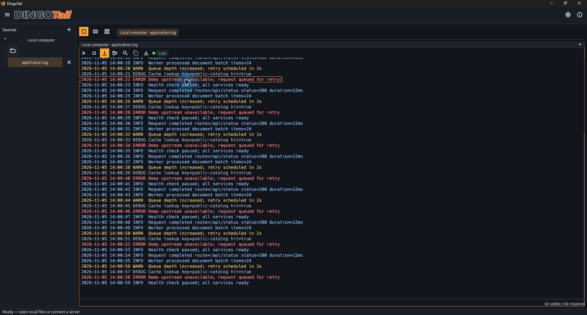
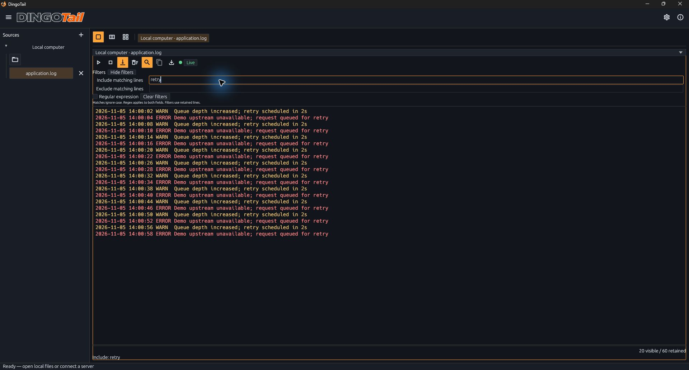
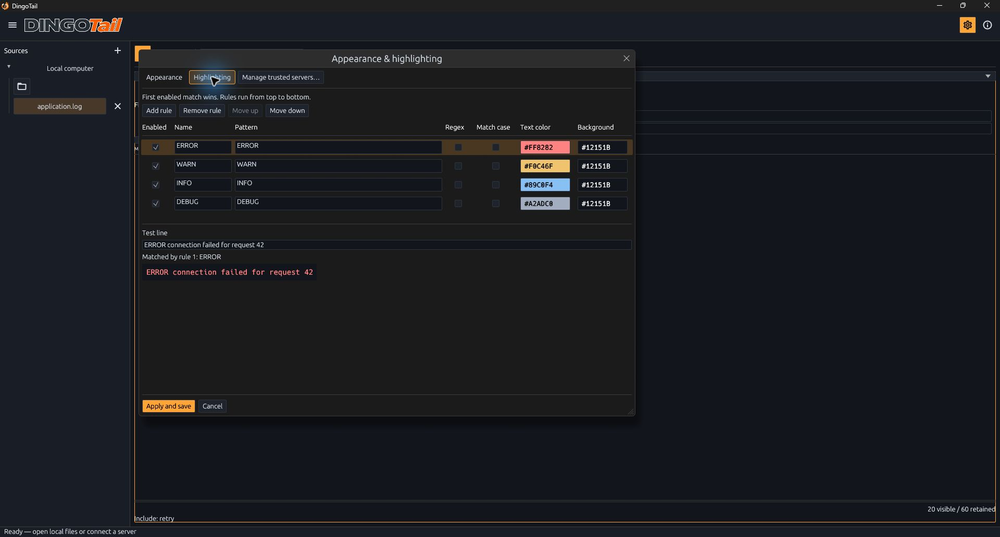

# DingoTail (Rust Edition)

<div align="center">
  
  <br />
  
  <br />
  <br />
</div>

DingoTail (Rust Edition) is a native desktop log viewer for following local text logs, remote files over SSH, and systemd journals. Put related sources side by side, filter each source independently, and highlight the lines you care about. This edition uses Rust and egui to support Windows, Linux, and macOS.

## Background

This edition is a spinoff of [DingoTail for Windows](https://github.com/jpdevoto/dingo-tail). DingoTail was originally built in Rust with egui. Performance issues in Windows virtual machines without GPU acceleration led us to port the application to C# and WinForms, improving its performance in those environments.

The Rust edition was continued to allow cross-platform support. The two editions share the same purpose: making local and remote logs easy to follow. The regular DingoTail edition focuses on native Windows use, including VMs without GPU acceleration; this edition continues the Rust/egui implementation for Windows, Linux, and macOS.

## Download v0.2.1

| Platform | Direct download | Checksum |
| --- | --- | --- |
| Windows x64 | [Download .exe](https://github.com/jpdevoto/dingo-tail-rust/releases/download/v0.2.1/DingoTail-0.2.1-windows-x64.exe) | [SHA-256](https://github.com/jpdevoto/dingo-tail-rust/releases/download/v0.2.1/DingoTail-0.2.1-windows-x64-SHA256SUMS.txt) |
| Linux x64 — Debian / Ubuntu | [Download .deb](https://github.com/jpdevoto/dingo-tail-rust/releases/download/v0.2.1/DingoTail-0.2.1-linux-deb-x64.deb) | [SHA-256](https://github.com/jpdevoto/dingo-tail-rust/releases/download/v0.2.1/DingoTail-0.2.1-linux-deb-x64-SHA256SUMS.txt) |
| Linux x64 — RPM | [Download .rpm](https://github.com/jpdevoto/dingo-tail-rust/releases/download/v0.2.1/DingoTail-0.2.1-linux-rpm-x64.rpm) | [SHA-256](https://github.com/jpdevoto/dingo-tail-rust/releases/download/v0.2.1/DingoTail-0.2.1-linux-rpm-x64-SHA256SUMS.txt) |
| macOS Intel | [Download .dmg](https://github.com/jpdevoto/dingo-tail-rust/releases/download/v0.2.1/DingoTail-0.2.1-macos-x64.dmg) | [SHA-256](https://github.com/jpdevoto/dingo-tail-rust/releases/download/v0.2.1/DingoTail-0.2.1-macos-x64-SHA256SUMS.txt) |
| macOS Apple Silicon | [Download .dmg](https://github.com/jpdevoto/dingo-tail-rust/releases/download/v0.2.1/DingoTail-0.2.1-macos-arm64.dmg) | [SHA-256](https://github.com/jpdevoto/dingo-tail-rust/releases/download/v0.2.1/DingoTail-0.2.1-macos-arm64-SHA256SUMS.txt) |

The v0.2.1 builds were tested successfully on Windows, Debian (DEB), and Fedora 45 (RPM). Testing is pending for macOS Intel and Apple Silicon. See the [changelog](CHANGELOG.md) for what changed. Matching source archives and branding archives are available on the [v0.2.1 release page](https://github.com/jpdevoto/dingo-tail-rust/releases/tag/v0.2.1).

## Run the Windows release

1. Download [DingoTail-0.2.1-windows-x64.exe](https://github.com/jpdevoto/dingo-tail-rust/releases/download/v0.2.1/DingoTail-0.2.1-windows-x64.exe).
2. Run the executable. The current release is unsigned; artwork and fonts are embedded, and no WebView runtime is required.

From the repository root in PowerShell:

```powershell
.\builds\windows-x64\DingoTail-0.2.1-windows-x64.exe
```

The default rendering mode uses OpenGL on ordinary desktops and prefers DX12 in Windows RDP sessions. The application also accepts `--renderer auto`, `--renderer hardware`, `--renderer software`, and the Windows-only `--dx12` backend override. Explicit software rendering requires a compatible DX12 CPU adapter, normally Windows WARP:

```powershell
.\builds\windows-x64\DingoTail-0.2.1-windows-x64.exe --renderer software
```

### Available platforms

| Platform | Availability and testing status |
| --- | --- |
| Windows x64 | v0.2.1 tested successfully. |
| Linux x64 | DEB tested on Debian. RPM tested on Fedora 45. |
| macOS Intel / Apple Silicon | Intel and Apple Silicon builds are available for download; testing is still pending. |

The project targets Windows 10/11, Ubuntu 22.04, Debian 12, RHEL-compatible 9, and macOS 13. These are target baselines, not a claim that every environment has been validated. See [platform requirements](PORTABILITY.md).

## Follow local and remote sources

Choose **Local computer → folder icon → Choose local files…**, or enter an absolute path and choose **Open path**. Use the layout buttons to switch among one, two, and four panes. Each source has controls to start and stop reading, resume auto-scroll, copy a selected line, and export matching retained lines.



*The Windows release follows a synthetic local application log with INFO, WARN, ERROR, and DEBUG highlighting. These documentation screenshots show the complete maximized application window using non-sensitive sample content.*

Local files support UTF-8 and BOM-marked UTF-16 LE/BE. Readers load the most recent complete lines and poll for new lines every 250 ms. Rotation and truncation produce visible markers. Source files remain read-only.

In v0.2.1, **Appearance > Initial lines to load** sets the starting history for local files, SSH files, and systemd journals. The default is 200 and the range is 1 to 20,000. Changes apply when a reader starts or restarts. Existing retention limits can reduce the number of lines kept.

Choose **Add server** to configure an SSH host, port, username, and password or private key. Use the server's folder control to browse files over SFTP or open a systemd journal source; an empty unit selects the system journal. Verify the server's host key fingerprint against a trusted source when prompted.

Remote file following requires SSH and a compatible `tail` command. Journal following requires `journalctl` and permission to read the requested journal. Optional read-only sudo browsing requires existing passwordless sudo permission for a supported external OpenSSH `sftp-server -R`. Log-command sudo is a separate option. DingoTail does not configure sudoers or change source-file permissions.

Workspace restoration preserves open sources and pane assignments, but readers start stopped. Each source retains its own filters, selection, scroll position, and follow state. Scrolling upward pauses auto-scroll without stopping the reader.

## Filter and highlight

Use the magnifier to open **Include matching lines** and **Exclude matching lines**. Matching ignores case by default; enable **Regular expression** to use patterns. Filters operate on each source's retained history, and the footer shows visible and retained counts.



*Filtering for `retry` shows 20 matching messages from 60 retained lines. Clearing filters restores the retained history.*

Open **Appearance & highlighting** with the gear button to adjust the palette and log font size, or change the order, patterns, and colors of highlighting rules. The first enabled matching rule wins. Changes remain a draft until **Apply and save**; Cancel discards the draft.



*The highlighting panel shows the default ERROR, WARN, INFO, and DEBUG rules, along with a preview of the first matching rule.*

Each source retains at most 20,000 lines or 16 MiB of raw text. Individual lines are limited to 64 KiB. Export writes the filtered retained buffer, rather than the entire original log file.

## Build from source

The application uses Rust 2024, eframe/egui, Tokio, russh/russh-sftp, serde, regex, rfd, image, and platform keyring backends. `Cargo.toml` declares dependencies and `Cargo.lock` pins their resolved versions.

On Windows, install Rust with the x64 MSVC toolchain, Visual Studio C++ build tools, and the Windows 10/11 SDK including `rc.exe`. Existing build records and the GitHub workflow specify Rust 1.98.1; `Cargo.toml` does not declare a minimum supported Rust version.

From the repository root:

```sh
cargo build --release --locked
```

The executable is `target/release/dingotail.exe` on Windows or `target/release/dingotail` on Linux/macOS. Building requires registry access or a populated Cargo cache; dependency sources are not vendored in this tree.

Linux requires a C/C++ compiler, pkg-config, D-Bus development headers, and an X11 or Wayland desktop with OpenGL/EGL and an XDG portal backend. macOS requires Xcode command-line tools; set `MACOSX_DEPLOYMENT_TARGET=13.0` for the packaging baseline. See [PORTABILITY.md](PORTABILITY.md) for native prerequisites.

### Settings and credentials

Windows uses `%APPDATA%/DingoTail/settings.json`; Linux uses `$XDG_CONFIG_HOME/dingotail/settings.json` or `~/.config/dingotail/settings.json`; macOS uses `~/Library/Application Support/DingoTail/settings.json`. An absolute `DINGOTAIL_CONFIG_DIR` overrides the directory and disables legacy import.

Passwords and passphrases are stored only when requested, using Windows Credential Manager, macOS Keychain, or Linux Secret Service. Linux credential storage needs session D-Bus and an unlocked Secret Service provider. Private key files remain at their original paths.

## Directory layout

| Path | Contents |
| --- | --- |
| `src/` | Rust application modules and egui interface |
| `assets/` | Embedded mascot, wordmark, icons, Material Icons font, and Windows resources |
| `docs/screenshots/` | Authentic captures of the existing Windows release |
| `builds/` | Windows, Linux DEB/RPM, and macOS Intel/Apple Silicon binaries and checksums; see [build downloads](builds/README.md) |
| `licenses/` | Third-party artwork and dependency notices |
| `packaging/` | Linux desktop entry and RPM specification |
| `tools/` | Native release packaging script |
| `.github/workflows/` | Manually triggered platform build and packaging workflow |
| `Cargo.toml`, `Cargo.lock` | Package manifest and locked dependencies |
| `build.rs`, `package.ps1` | Windows resource compilation and build/package entry point |

## License and notices

The code is licensed under GPL-3.0-only. Branding and Material Icons have separate terms. Third-party components retain their own licenses.

[License](LICENSE) · [Copyright](COPYRIGHT) · [Branding terms](BRANDING.md) · [Material Icons license](licenses/Material-Icons-LICENSE.txt) · [Third-party notices](licenses/THIRD-PARTY-NOTICES.txt)
